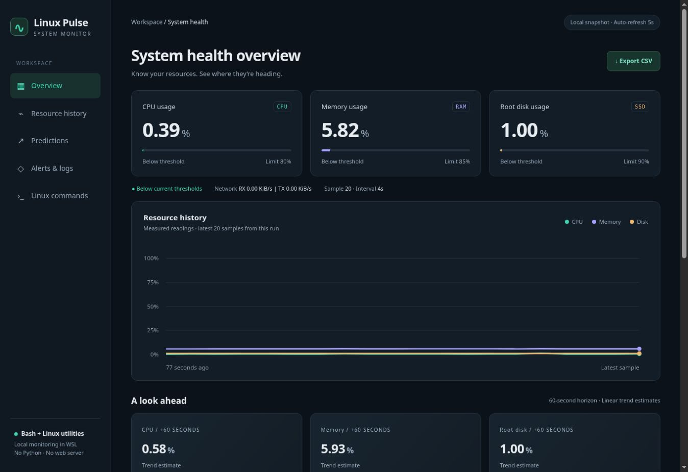

# Linux System Health & Predictive Monitoring

A lightweight Linux monitoring project built with **Bash and standard Linux commands**. It collects system resource readings, records a CSV history, estimates short-term usage trends, and generates a browser dashboard for local monitoring.

**Stack:** Bash · awk · Linux `/proc` interfaces · HTML · CSS · SVG

## Dashboard preview



*Actual dashboard generated during the recorded Linux verification run. This image is a historical snapshot; running the collector generates readings from your own Linux environment.*

## Features

- **Resource monitoring:** CPU, memory, root filesystem usage, and network receive/transmit rates.
- **Browser dashboard:** Resource cards, measured history charts, prediction cards, active warnings, and recent readings.
- **Predictive monitoring:** Linear trend estimates for CPU, memory, and disk usage 60 seconds ahead.
- **Configurable alerts:** Current threshold warnings and qualified predicted warnings.
- **CSV history:** Timestamped observations that can be inspected from the terminal or opened in a spreadsheet.
- **Verification script:** Ten checks covering collection, output files, warning behavior, and known-input prediction cases.

The runtime uses Bash and common Linux utilities. No Python, Node.js, database service, JavaScript library, or web server is required.

## Requirements

- Linux with readable `/proc/stat`, `/proc/meminfo`, and `/proc/net/dev` interfaces. Ubuntu inside WSL is supported by the project workflow.
- Bash, `awk`, `df`, `date`, `tail`, `sleep`, `mkdir`, `mktemp`, `mv`, and other standard shell utilities.
- A writable project directory and a browser such as Chrome, Edge, or Firefox.
- Git and an internet connection to clone the repository. Normal monitoring works offline.

Keep `linux_health.sh`, `dashboard.awk`, and `dashboard.template.html` together.

## Quick start

### 1. Clone the repository

Run these commands in your Linux or WSL terminal:

```bash
git clone https://github.com/20RITVIK06/Linux_Health_Monitor.git
cd Linux_Health_Monitor
```

### 2. Start monitoring

```bash
bash linux_health.sh
```

The collector uses a five-second sampling delay by default. After the first sample, it creates the dashboard at:

```text
health-data/dashboard.html
```

### 3. Open the dashboard

Open `health-data/dashboard.html` in a browser. On WSL, use a second terminal in the project directory to open Windows File Explorer:

```bash
explorer.exe .
```

Then open **health-data → dashboard.html** in Chrome or Edge. You can also run `explorer.exe .` before starting the collector.

Keep the monitoring terminal running. The page reloads every five seconds; allow approximately two minutes for the first predictions. Press **Ctrl+C** in the monitoring terminal to stop.

**Check the last-sample timestamp:** the page retains its last snapshot after the collector stops. Reloading the page alone does not collect new readings.

## How it works

| Stage | Implementation |
| --- | --- |
| Collect | Read CPU, memory, and network counters from `/proc`; read root filesystem usage with `df -P /`. |
| Calculate | Use Bash and `awk` to calculate percentages and network rates from successive readings. |
| Record | Append epoch time and CPU, memory, and disk percentages to `metrics.csv`. |
| Forecast | Fit a straight line to the latest 20 observations from the current run. |
| Evaluate | Compare current values and qualifying forecasts with configured limits. |
| Render | Use `dashboard.awk` and the HTML template to generate the dashboard, then replace the output file with `mv`. |

### Resource measurements

| Metric | Source | Interpretation |
| --- | --- | --- |
| CPU | `/proc/stat` | Usage calculated from changes in total and idle counters. |
| Memory | `/proc/meminfo` | `100 × (MemTotal − MemAvailable) / MemTotal`. |
| Root disk | `df -P /` | Root filesystem capacity used, reported at whole-percent resolution. |
| Network | `/proc/net/dev` | Combined non-loopback receive and transmit rates in KiB/s. |

Network rates appear in the terminal and dashboard; they are not stored as CSV columns in this version. In WSL, the readings describe the Linux environment rather than all Windows applications.

## Predictive monitoring

The project uses ordinary least-squares linear regression:

```text
Estimated usage = intercept + slope × elapsed time
```

The model evaluates that line **60 seconds beyond the latest observation** and limits the result to 0–100%.

- History window: latest **20 samples** from the current run.
- Minimum history: those samples must span **at least 60 seconds**.
- Default sampling delay: **5 seconds**, giving the first forecast after approximately **100 seconds**.
- Fit indicator: **R²**, which describes the fit to past observations rather than future accuracy.

Use the default sampling interval for demonstrations. Intervals of 1–3 seconds can keep the 20-sample window below the required 60-second span. A backward clock change or a long sampling gap resets the recent history.

These forecasts are estimates of recent resource trends. They do not predict hardware failures, and sudden workload changes can make them inaccurate.

## Configuration

```bash
bash linux_health.sh --help
```

| Option | Default | Description |
| --- | --- | --- |
| `--interval N` | `5` | Sampling delay in whole seconds, from 1 to 60. |
| `--samples N` | `0` | Stop after N samples; `0` runs continuously. |
| `--cpu-threshold N` | `80` | CPU warning limit, from 0 to 100%. |
| `--memory-threshold N` | `85` | Memory warning limit, from 0 to 100%. |
| `--disk-threshold N` | `90` | Root disk warning limit, from 0 to 100%. |
| `--data-dir PATH` | `./health-data` | Directory for readings, generated HTML, and warning logs. |

For a finite run using a separate output directory:

```bash
bash linux_health.sh --interval 5 --samples 20 --data-dir session-data
```

Open `session-data/dashboard.html` for this run. The browser refresh interval remains five seconds even when the collector interval changes.

## Alerts

**Current warning:** the measured resource percentage reaches or exceeds its configured limit.

**Predicted warning:** current usage is below the limit, the trend is rising, R² is at least 0.5, and the 60-second estimate reaches or exceeds the limit.

Warnings are appended to `alerts.log` on qualifying cycles. Repeated warnings are not suppressed, and separate cleared events are not recorded.

### Safe alert demonstration

Stop the normal collector with **Ctrl+C**, then run:

```bash
bash linux_health.sh --cpu-threshold 0 --data-dir demo-data
```

Open `demo-data/dashboard.html`. A banner identifies the demonstration. The CPU reading is real; the deliberately low threshold triggers the warning without generating an overload.

Stop the demonstration and restart `bash linux_health.sh` to restore the normal limits.

## Output files

| File | Purpose |
| --- | --- |
| `health-data/metrics.csv` | Timestamped CPU, memory, and disk observations. |
| `health-data/dashboard.html` | Automatically generated browser dashboard. |
| `health-data/alerts.log` | Warning messages; created on the first warning. |

CSV schema:

```csv
epoch,cpu_percent,memory_percent,disk_percent
```

Inspect the output from your terminal:

```bash
tail -n 5 health-data/metrics.csv
tail -n 10 health-data/alerts.log
```

The dashboard's **Export CSV** link points to `metrics.csv` in the same output directory. Depending on local-file browser behavior, it may download the CSV or open it directly.

## Verification

From a fresh checkout, run:

```bash
bash VERIFY_PROJECT.sh
```

The script performs ten checks covering Bash syntax, a real Linux sample, CSV output, low-threshold logging, dashboard rendering, warmup requirements, and known-input forecast cases.

Verification writes to `validation-data/`. The current script expects fresh test output; rerunning it with an existing validation CSV can fail its single-row check. Known input series are explicitly identified as test fixtures, not live resource measurements.

Recorded evidence in [`Verified_Outputs/`](Verified_Outputs/) comes from a controlled Linux run on **25 October 2026**. It includes 20 actual readings spanning 77 seconds and a validation transcript reporting ten passed checks. Those files are historical evidence rather than current readings from your computer.

## Project files

| File or directory | Contents |
| --- | --- |
| [`linux_health.sh`](linux_health.sh) | Bash collector, terminal output, command-line options, and warning logging. |
| [`dashboard.awk`](dashboard.awk) | Calculations, forecasts, chart paths, and HTML rendering. |
| [`dashboard.template.html`](dashboard.template.html) | Responsive HTML/CSS frontend with SVG charts. |
| [`VERIFY_PROJECT.sh`](VERIFY_PROJECT.sh) | Verification checks. |
| [`START_HERE.txt`](START_HERE.txt) | Windows ZIP setup and classroom launch instructions. |
| [`README.txt`](README.txt) | Additional implementation notes. |
| [`Verified_Outputs/`](Verified_Outputs/) | Captured commands, source excerpts, plots, and dashboard evidence. |

## Documentation

- [Project report](Linux_System_Health_Report1.pdf)
- [Presentation with speaker notes](Linux_Health_Project_Commands.pptx)

## Current limitations

- One Linux environment is monitored per collector; run only one collector per output directory.
- Prediction history starts fresh on each run, even when an existing CSV is retained.
- CSV and log files have no automatic retention or rotation.
- Epoch timestamps are used for elapsed-time calculations, so clock changes can affect rates.
- Remote monitoring, email notifications, scheduled startup, and automatic remediation are not implemented.

## Future improvements

- Log rotation and retention policies.
- Persisted network-rate columns and per-process resource information.
- Duplicate-warning suppression and explicit recovery events.
- Scheduled startup and backups through verified Linux services.
- Forecast evaluation against later observations.
- Notifications and monitoring across multiple machines.
